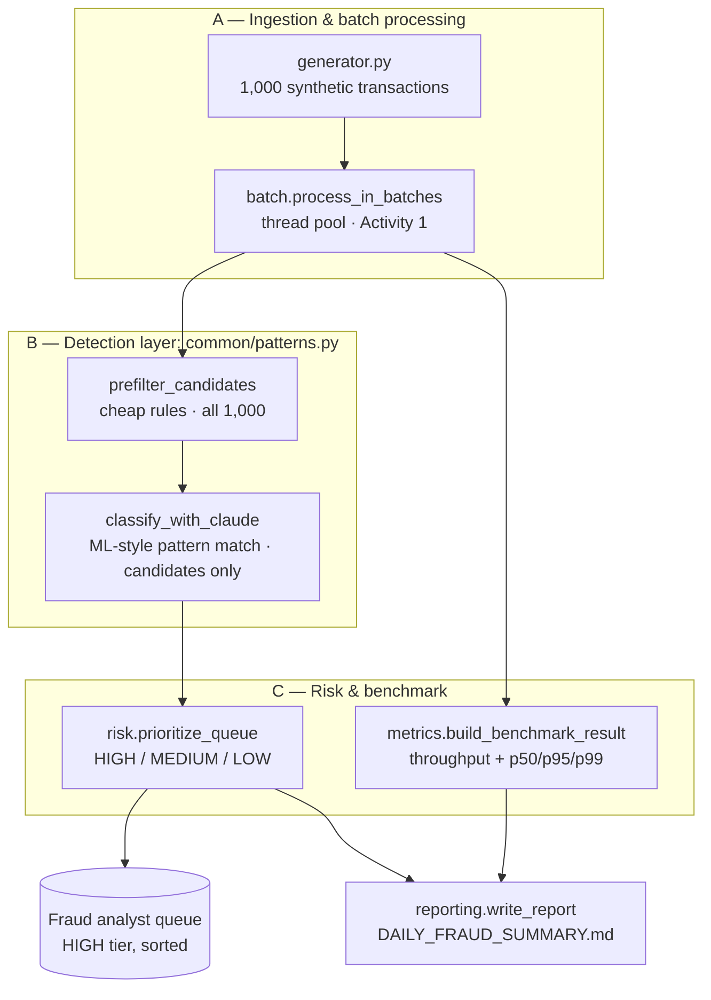
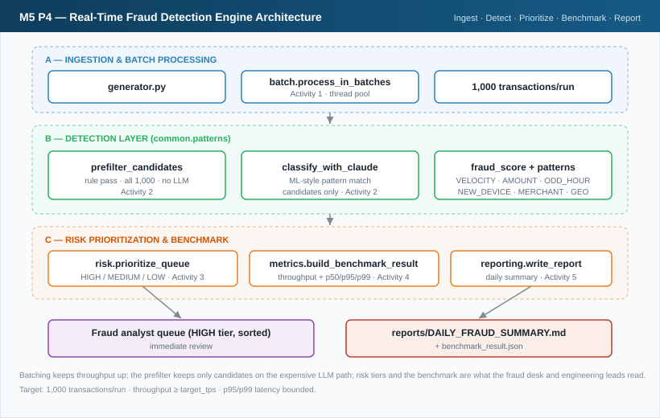
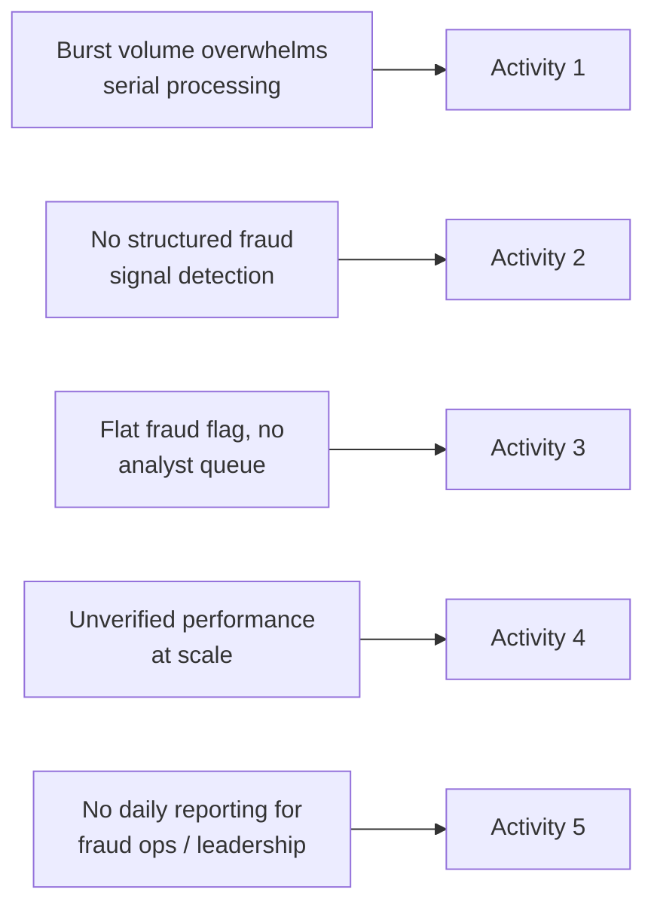
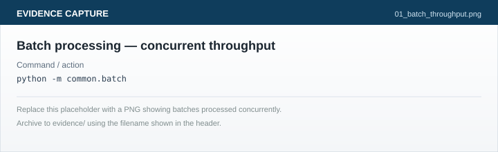
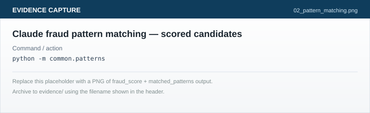
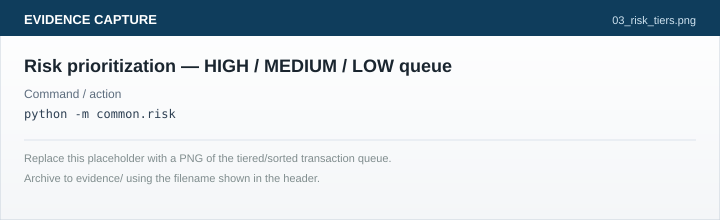
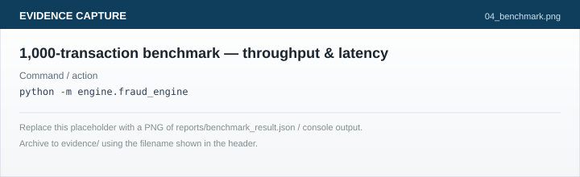
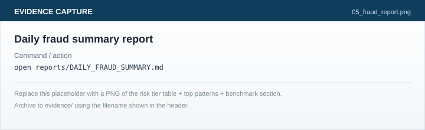

# Guided Activity: Real-Time Fraud Detection at Scale


| | |
|:--|:--|
| **Audience** | Fraud engineering leads · Risk & compliance engineers · Senior backend engineers |
| **Duration** | ~45 minutes |
| **Platform** | Windows & Linux |
| **API** | OpenRouter |
| **Assessment** | LMS review ≥ 80/100 · acceptance criteria met in every activity |
| **Scale target** | 1,000 transactions/run · throughput ≥ target tps |

> [!NOTE]
> **Executive summary:** The bank's transaction volume peaks in bursts that a
> one-at-a-time fraud check cannot keep up with. In this lab you build a
> real-time fraud detection engine: batch-process transactions concurrently
> for throughput, apply ML-style pattern matching with Claude to flag fraud
> signals, prioritize the result into a HIGH/MEDIUM/LOW analyst queue,
> benchmark the engine against 1,000 transactions, and generate the daily
> fraud summary report the fraud operations desk reads every morning.

> [!IMPORTANT]
> **Independent lab** — bootstrap `workspace/` only. No other projects required. This folder bundles its own `fraud-detection-starter/` alongside `starter_files/`, so bootstrap works entirely standalone.

> [!TIP]
> **Evidence capture** — Each activity ends with an open block: **Execute** · **Capture** · **Reference output**. Archive PNGs to `evidence/` for programme sign-off.

> [!WARNING]
> This lab calls Claude for pattern matching (Activity 2) — never send the full 1,000-transaction feed to the model. `common/patterns.py` is deliberately split into a cheap rule prefilter (all transactions) and an LLM classification step (candidates only); sending everything to the LLM will blow both your latency budget and your API usage.

## Quick navigation

- [Lab environment & local runtime](#lab-environment--local-runtime)
- [Activity 0 — Architecture](#activity-0-study-and-design-the-system-architecture)
- [Activity 1 — Batch processing](#activity-1-batch-transaction-processing-for-throughput)
- [Activity 2 — Pattern matching](#activity-2-ml-style-pattern-matching-with-claude)
- [Activity 3 — Risk prioritization](#activity-3-real-time-risk-prioritization)
- [Activity 4 — Scale & benchmark](#activity-4-process-1000-transactions--benchmark-latency-and-throughput)
- [Activity 5 — Daily fraud report](#activity-5-generate-the-daily-fraud-summary-report)
- [Execution plan](#lab-execution-plan)
- [Deliverables & evidence](#deliverables--evidence)
- [Completion checklist](#completion-checklist)

## Lab execution plan

| # | Phase | Est. | Done |
|:-:|-------|:----:|:----:|
| 1 | Bootstrap `workspace/` | 4 min | ☐ |
| 2 | **Activity 0 — Study &amp; design the architecture** | 7 min | ☐ |
| 3 | Activity 1 — Batch transaction processing | 7 min | ☐ |
| 4 | Activity 2 — ML-style pattern matching with Claude | 8 min | ☐ |
| 5 | Activity 3 — Real-time risk prioritization | 6 min | ☐ |
| 6 | Activity 4 — Process 1,000 txns + benchmark | 6 min | ☐ |
| 7 | Activity 5 — Daily fraud summary report | 5 min | ☐ |
| 8 | Final review + evidence upload + LMS | 2 min | ☐ |

## Competencies demonstrated

| Competency | How it is verified |
|------------|-------------------|
| Scalable engine design | Architecture study + design worksheet answers (Activity 0) |
| High-throughput processing | Concurrent batch processing (`common.batch`) |
| AI-assisted fraud detection | ML-style pattern matching via Claude (`common.patterns`) |
| Risk-based decisioning | HIGH/MEDIUM/LOW prioritization (`common.risk`) |
| Performance engineering | Latency (p50/p95/p99) and throughput benchmark vs. target |
| Business reporting | Daily fraud summary report with pattern analysis |

## Activity convention

| Label | Meaning |
|-------|---------|
| **Action / Prompt** | Commands or prompts to run |
| **Expected result** | Normal successful outcome |
| **Acceptance criteria** | Condition required to proceed |
| **Evidence capture** | Execute · Capture · Reference output — archive to `evidence/` |

---

## Reference materials

| Resource | Location | Purpose |
|----------|----------|---------|
| **Architecture study** | [Activity 0](#activity-0-study-and-design-the-system-architecture) in this guide | **Start here** — pipeline stages, design worksheet |
| System architecture SVG | `starter_files/diagrams/p4_system_architecture.svg` | Static diagram (offline / LMS) |
| Concepts deep dive | `starter_files/resources/CONCEPTS.md` | The five components + why the design is shaped this way |
| Prompt library | `starter_files/resources/PROMPT_LIBRARY.md` | Copy-paste prompts per activity |
| Experiment lab | `starter_files/resources/EXPERIMENTS.md` | 6 optional experiments |
| Pattern reference | `starter_files/resources/pattern_reference.py` | Reference implementations of all five controls |
| Report template | `starter_files/resources/fraud_summary_report_template.md` | Daily fraud summary report shape |
| Settings | `starter_files/settings_template.json` | Model routing for Claude Code |
| Bootstrap script | `starter_files/bootstrap_workspace.sh` / `.py` | One-command workspace setup |
| Troubleshooting | `starter_files/resources/TROUBLESHOOTING.md` | Fix common failures |

---

## Business context

A major retail bank processes thousands of card and account transactions a
day, with sharp peaks around salary days, festival shopping, and month-end
bill cycles. The existing fraud check is a simple per-transaction rule set
that cannot express pattern-based fraud (velocity abuse, device/geo
mismatches, unusual merchant combinations) and cannot keep pace with peak
volume without adding latency to every single card swipe. Fraud operations
needs a redesigned engine that processes bursts of transactions concurrently,
applies smarter pattern detection where it actually matters, and hands the
desk a prioritized queue plus a daily report — not a raw transaction dump.

---

## Topics covered

| Topic | What you will do |
|---|---|
| Scalable engine architecture | Study and label the ingest → detect → prioritize → report pipeline |
| Batch & concurrent processing | Chunk 1,000 transactions and process batches on a thread pool |
| AI-assisted pattern matching | Rule prefilter + Claude classification for fraud signals |
| Risk-tiered decisioning | HIGH / MEDIUM / LOW prioritization for the analyst queue |
| Performance benchmarking | Throughput (tps) and p50/p95/p99 latency at 1,000-transaction scale |
| Fraud reporting | Daily fraud summary report with pattern analysis for the fraud desk |

---

## Competency outcome

You will build a fraud detection engine that processes 1,000 synthetic
transactions end to end, identifies fraud patterns using a cost-aware
rule-then-Claude design, tiers every transaction into an actionable risk
queue, proves the engine meets a throughput target under load, and produces
a daily fraud summary report suitable for the fraud operations desk.

---

## Lab environment & local runtime

> [!IMPORTANT]
> **All environment and credential steps are in this guide.** Do not rely on separate setup documents.

> [!WARNING]
> Never commit keys. Use environment variables and `${VAR}` placeholders only.

### Project folder

| Item | Path |
|------|------|
| **Project root** | this folder |
| **Working directory** | `workspace/` (created by bootstrap) |

> [!NOTE]
> **`workspace/` does not exist until you bootstrap.** If `cd .../workspace` returns *No such file or directory*, run bootstrap first (below) — it copies `fraud-detection-starter` (bundled at the project root) into `workspace/`.

### OpenRouter environment (pre-configured in Wipro lab)

Typical `~/.bashrc` already includes `OPENROUTER_API_KEY`, `ANTHROPIC_BASE_URL=https://openrouter.ai/api`, `ANTHROPIC_AUTH_TOKEN`, `ANTHROPIC_API_KEY=""`, and often `source ~/venv/bin/activate`.

**Verify** — do not edit `~/.bashrc` unless verification fails:

```bash
source ~/.bashrc
echo "BASE_URL=$ANTHROPIC_BASE_URL"
echo "API_KEY_EMPTY=$([ "$ANTHROPIC_API_KEY" = "" ] && echo yes || echo no)"
test -n "$OPENROUTER_API_KEY" && echo "OPENROUTER: set" || echo "OPENROUTER: MISSING"
claude --version
```

**Pass when:** `BASE_URL=https://openrouter.ai/api` · `API_KEY_EMPTY=yes` · `OPENROUTER: set`

| Symptom | Fix |
|---------|-----|
| `OPENROUTER: MISSING` | New terminal + `source ~/.bashrc`; contact lab support |
| `API_KEY_EMPTY=no` | `export ANTHROPIC_API_KEY=""` in current session |
| `401` from `claude -p` | Lab admin must refresh `OPENROUTER_API_KEY` |

<details>
<summary><strong>Bootstrap</strong></summary>

```bash
# Linux:   bash starter_files/bootstrap_workspace.sh
# Windows: python starter_files/bootstrap_workspace.py
```

Bootstrap prints the `workspace/` path it created (e.g. `Workspace ready: .../workspace`).

```bash
cd workspace
pip install -r requirements.txt
```

</details>

### Prerequisites checklist

- Python 3.10+, Git, Claude Code CLI
- OpenRouter verified (see above)
- `anthropic` installed (`pip install -r requirements.txt`)
- Working directory: `workspace/`

---
---
---

# Activity 0: Study and design the system architecture

Maps to curriculum: *Design a scalable fraud detection engine architecture for high-volume BFSI workloads*

> [!IMPORTANT]
> **Mandatory first activity.** Complete all steps below before **Activity 1**.

> [!NOTE]
> Static SVG (for viewers without Mermaid): `starter_files/diagrams/p4_system_architecture.svg` · After bootstrap: `workspace/lab_resources/diagrams/p4_system_architecture.svg`

## Step 0.1 — Architecture diagram (this project)





---

## Step 0.2 — Three design decisions that make it scalable

| Decision | Where it lives | Why it matters for high-volume BFSI workloads |
|----------|-----------------|------------------------------------------------|
| **Batch + concurrency** | `common.batch.process_in_batches` | A serial, one-at-a-time check cannot absorb a peak-hour burst without growing latency linearly |
| **Filter before you call the model** | `common.patterns.prefilter_candidates` | Sending all 1,000 transactions to an LLM on every run is slow and costly; only ambiguous cases need judgment |
| **Tiered decisioning, not one verdict** | `common.risk.prioritize_queue` | The fraud desk has finite analyst capacity — HIGH must be a short, sorted, actionable list, not a flat "fraud/not fraud" flag |

They are **complementary** — batching keeps the pipeline moving, the prefilter keeps the expensive step cheap, and tiering turns a score into a decision the business can act on.

---

## Step 0.3 — Where each activity fits



Open `engine/fraud_engine.py` and read the `# BUILD:` comments — each one names the activity that completes it.

---

## Step 0.4 — Map activities → components

| Activity | Component | Delivers |
|----------|-----------|----------|
| 1 | `common.batch` | Throughput via concurrent batch processing |
| 2 | `common.patterns` | Fraud signal detection (rules + Claude) |
| 3 | `common.risk` | HIGH/MEDIUM/LOW risk prioritization |
| 4 | `engine.fraud_engine` + `common.metrics` | 1,000-transaction run + throughput/latency benchmark |
| 5 | `common.reporting` | Daily fraud summary report |

---

## Step 0.5 — Design worksheet (study questions)

1. Why must `prefilter_candidates` run before any call to Claude, rather than the other way around?
2. Why is `ThreadPoolExecutor` the right concurrency primitive here rather than multiple processes?
3. What breaks in the fraud desk's workflow if `assign_risk_tier` only ever returned "FRAUD" / "NOT_FRAUD" instead of three tiers?
4. Why does the engine benchmark throughput **and** p95/p99 latency, not just an average?
5. If throughput comes in below target in Activity 4, name two knobs in `engine/fraud_engine.py` you could tune, and the tradeoff each one carries.

<details>
<summary><strong>Answers</strong></summary>

1. The prefilter is a cheap, deterministic, all-1,000-transaction pass; the LLM call is the expensive step. Reversing the order means paying LLM latency/cost on every transaction, which defeats the point of a real-time engine.
2. Pattern matching is I/O-bound (waiting on an LLM response over the network), not CPU-bound — threads give you concurrency without the overhead of separate processes and shared-nothing serialization.
3. Analysts would either get flooded (everything above threshold treated the same, no way to prioritize) or miss borderline cases that deserve step-up verification instead of an outright block.
4. An average hides tail behavior — a handful of slow batches can starve the analyst queue even if the mean latency looks fine; p95/p99 is what "keeps pace with peak volume" actually measures.
5. `DEFAULT_BATCH_SIZE` (bigger batches = fewer, chunkier calls but more per-batch latency) and `DEFAULT_MAX_WORKERS` (more workers = more parallelism but risk of provider rate limits/errors).

</details>

## Step 0.6 — Acceptance gate

**Action:** Sketch the five pipeline stages and label which Activity implements each one.

**Acceptance criteria:** You can explain the transaction path — generated → batched → prefiltered → classified → tiered → benchmarked → reported — without the diagram. Proceed to Activity 1 only when complete.

---

# Activity 1: Batch transaction processing for throughput

Maps to curriculum: *Implement batch transaction processing for throughput optimization*

## Step 1.1 — Implement `common/batch.py`

**Action:** Implement `chunk_transactions` and `process_in_batches`. Remove every `raise NotImplementedError` and `# TODO(P4)` marker. Pattern: `starter_files/resources/pattern_reference.py`.

**Prompt for Claude Code:**

```
Implement common/batch.py:
- chunk_transactions(transactions, batch_size): generator yielding fixed-size
  slices of the list, last slice may be shorter, no dropped/duplicated items.
- process_in_batches(transactions, worker_fn, batch_size, max_workers): use
  concurrent.futures.ThreadPoolExecutor(max_workers=max_workers) to run
  worker_fn on every batch from chunk_transactions concurrently, then flatten
  the per-batch results back into one list preserving submission order.
Remove all NotImplementedError and TODO(P4) markers.
```

**Acceptance criteria:**
- `list(chunk_transactions(list(range(7)), batch_size=3))` has 3 chunks of sizes `[3, 3, 1]`
- `process_in_batches` on 100 dummy transactions with a `worker_fn` that returns its input unchanged returns all 100 items, same order they went in

**Verify yourself, don't just trust the summary:**

```bash
python3 -c "
from common.batch import chunk_transactions, process_in_batches
chunks = list(chunk_transactions(list(range(7)), batch_size=3))
print('chunk sizes:', [len(c) for c in chunks])
out = process_in_batches(list(range(20)), worker_fn=lambda b: b, batch_size=5, max_workers=4)
print('round-trip ok:', out == list(range(20)))
"
```

<details open>
<summary><strong>Evidence capture — Batch processing runs concurrently</strong></summary>

| Field | Detail |
|-------|--------|
| **Execute** | Step 1.1 verify snippet |
| **Capture** | Terminal showing chunk sizes and `round-trip ok: True` |
| **Reference output** | `chunk sizes: [3, 3, 1]` · `round-trip ok: True` |



> **Archive as:** `evidence/01_batch_throughput.png`

</details>

---

# Activity 2: ML-style pattern matching with Claude

Maps to curriculum: *Apply ML-style pattern matching using Claude for fraud signal identification*

## Step 2.1 — Implement `common/patterns.py`

**Prompt:**

```
Implement common/patterns.py:
- prefilter_candidates(transactions): rule pass over ALL transactions, no LLM
  call — flag amount_inr > AMOUNT_THRESHOLD_INR, hour_of_day in ODD_HOURS,
  merchant_category in HIGH_RISK_MERCHANTS, or "NEW" in device_id.
- classify_with_claude(candidates, model): build one batch prompt from the
  candidates using CLASSIFY_SYSTEM_PROMPT as the system message, call
  get_llm_client().messages.create(model=resolve_model(model), ...), parse
  the JSON array response (strip markdown fences defensively) into
  {txn_id: {fraud_score, matched_patterns}}.
- detect_fraud_signals(transactions): prefilter, classify only the
  candidates, merge scores back onto the full list (default score 0 / [] for
  anything not flagged).
Remove all NotImplementedError and TODO(P4) markers.
```

**Acceptance criteria:**
- `prefilter_candidates` on 1,000 generated transactions returns roughly 5-12% of them (the seeded anomaly rate)
- `detect_fraud_signals` returns every input transaction, each with `fraud_score` (int) and `matched_patterns` (list) present
- No transaction sent to `classify_with_claude` is missing from the prefiltered candidate set (never the full 1,000)

**Verify:**

```bash
python3 -c "
from common.generator import generate_transactions
from common.patterns import prefilter_candidates, detect_fraud_signals
sample = generate_transactions(count=1000, seed=42)
candidates = prefilter_candidates(sample)
print(f'{len(candidates)}/{len(sample)} flagged for Claude review')
scored = detect_fraud_signals(sample[:20])
print('all scored:', all('fraud_score' in t and 'matched_patterns' in t for t in scored))
"
```

<details open>
<summary><strong>Evidence capture — Pattern matching scores candidates</strong></summary>

| Field | Detail |
|-------|--------|
| **Execute** | Step 2.1 verify snippet |
| **Capture** | Terminal showing candidate count and `all scored: True` |
| **Reference output** | `62/1000 flagged for Claude review` · `all scored: True` |



> **Archive as:** `evidence/02_pattern_matching.png`

</details>

---

# Activity 3: Real-time risk prioritization

Maps to curriculum: *Implement real-time risk prioritization — high / medium / low risk tiers*

## Step 3.1 — Implement `common/risk.py`

**Prompt:**

```
Implement common/risk.py:
- assign_risk_tier(fraud_score, matched_patterns): HIGH if fraud_score >= 70
  or 2+ matched patterns; MEDIUM if fraud_score >= 40 or exactly 1 matched
  pattern; else LOW.
- prioritize_queue(scored_transactions): bucket by tier using
  assign_risk_tier, sort HIGH by fraud_score descending, return
  {"HIGH": [...], "MEDIUM": [...], "LOW": [...], "counts": {...}}.
Remove all NotImplementedError and TODO(P4) markers.
```

**Acceptance criteria:**
- `assign_risk_tier(82, ["AMOUNT_ANOMALY", "ODD_HOUR"])` returns `"HIGH"`
- `assign_risk_tier(45, ["NEW_DEVICE"])` returns `"MEDIUM"`
- `assign_risk_tier(5, [])` returns `"LOW"`
- `prioritize_queue(...)["HIGH"]` is sorted by `fraud_score` descending

**Verify:**

```bash
python3 -c "
from common.risk import assign_risk_tier, prioritize_queue
print(assign_risk_tier(82, ['AMOUNT_ANOMALY', 'ODD_HOUR']))
print(assign_risk_tier(45, ['NEW_DEVICE']))
print(assign_risk_tier(5, []))
demo = [
    {'txn_id': 'TXN-1', 'fraud_score': 61, 'matched_patterns': ['AMOUNT_ANOMALY']},
    {'txn_id': 'TXN-2', 'fraud_score': 91, 'matched_patterns': ['AMOUNT_ANOMALY', 'ODD_HOUR']},
]
q = prioritize_queue(demo)
print('HIGH order:', [t['txn_id'] for t in q['HIGH']], q['counts'])
"
```

<details open>
<summary><strong>Evidence capture — Risk tiers assigned and sorted</strong></summary>

| Field | Detail |
|-------|--------|
| **Execute** | Step 3.1 verify snippet |
| **Capture** | Terminal showing `HIGH`/`MEDIUM`/`LOW` and the sorted HIGH-tier order |
| **Reference output** | `HIGH` · `MEDIUM` · `LOW` · `HIGH order: ['TXN-2'] {'HIGH': 1, 'MEDIUM': 1, 'LOW': 0}` |



> **Archive as:** `evidence/03_risk_tiers.png`

</details>

---

# Activity 4: Process 1,000 transactions & benchmark latency and throughput

Maps to curriculum: *Process huge transactions and benchmark latency and throughput*

## Step 4.1 — Run the engine end to end

**Action:** With Activities 1-3 implemented, run `engine/fraud_engine.py` over the full 1,000-transaction feed and confirm the benchmark meets `target_tps`.

**Prompt:**

```
Run engine/fraud_engine.py's run_fraud_detection(count=1000). Confirm
reports/benchmark_result.json is written with throughput_tps and
p50/p95/p99 latency. If throughput_tps is below target_tps (150 by
default), tune DEFAULT_BATCH_SIZE / DEFAULT_MAX_WORKERS in
engine/fraud_engine.py, re-run, and explain the tradeoff you made.
```

**Acceptance criteria:**
- `reports/benchmark_result.json` exists with `total_transactions == 1000`
- `throughput_tps >= target_tps` (or you document the tuning attempt and residual gap)
- `p95_latency_ms` and `p99_latency_ms` are present and finite

**Verify:**

```bash
python3 -m engine.fraud_engine
cat reports/benchmark_result.json
```

<details open>
<summary><strong>Evidence capture — 1,000-transaction benchmark</strong></summary>

| Field | Detail |
|-------|--------|
| **Execute** | Step 4.1 verify — run the engine, then `cat` the benchmark file |
| **Capture** | Console output plus `reports/benchmark_result.json` showing throughput and latency percentiles |
| **Reference output** | `{"total_transactions": 1000, "throughput_tps": 210.4, "p95_latency_ms": 38.2, "meets_target": true, ...}` |



> **Archive as:** `evidence/04_benchmark.png`

</details>

---

# Activity 5: Generate the daily fraud summary report

Maps to curriculum: *Generate daily fraud summary report with pattern analysis*

## Step 5.1 — Implement `common/reporting.py` and produce the report

**Prompt:**

```
Implement common/reporting.py:
- generate_daily_summary(prioritized, benchmark): total_transactions,
  tier_counts (from prioritized["counts"]), top_patterns (frequency of
  matched_patterns across HIGH+MEDIUM transactions, sorted desc),
  amount_at_risk_inr (sum of amount_inr over the HIGH tier), and benchmark.
- write_report(summary): render reports/DAILY_FRAUD_SUMMARY.md following
  starter_files/resources/fraud_summary_report_template.md — executive
  summary, risk tier breakdown table, top fraud patterns table, throughput &
  latency benchmark table, recommendations. Return the path written.
Then remove every remaining "# BUILD:" marker in engine/fraud_engine.py once
you've confirmed each one is wired to a real, implemented function. Remove
all NotImplementedError and TODO(P4) markers.
```

**Acceptance criteria:**
- `reports/DAILY_FRAUD_SUMMARY.md` exists
- Contains a risk tier breakdown, a top-patterns table, and a throughput/latency section
- `engine/fraud_engine.py` no longer contains any `# BUILD:` marker

<details open>
<summary><strong>Evidence capture — Daily fraud summary report</strong></summary>

| Field | Detail |
|-------|--------|
| **Execute** | Open `reports/DAILY_FRAUD_SUMMARY.md` |
| **Capture** | Risk tier table + top patterns table + benchmark section visible |
| **Reference output** | Tier counts summing to 1,000; benchmark section shows `throughput_tps` and `p95`/`p99` |



> **Archive as:** `evidence/05_fraud_report.png`

</details>

---

# Deliverables & evidence

Upload the PNG files saved at each evidence block above.

| # | File | Captured at step |
|---|------|------------------|
| 1 | `evidence/01_batch_throughput.png` | Activity 1 — Step 1.1 |
| 2 | `evidence/02_pattern_matching.png` | Activity 2 — Step 2.1 |
| 3 | `evidence/03_risk_tiers.png` | Activity 3 — Step 3.1 |
| 4 | `evidence/04_benchmark.png` | Activity 4 — Step 4.1 |
| 5 | `evidence/05_fraud_report.png` | Activity 5 — Step 5.1 |

---

# Completion checklist

## Environment

- [ ] Workspace bootstrapped (`workspace/`)
- [ ] OpenRouter env verified
- [ ] `anthropic` installed
- [ ] `python -c "from engine.fraud_engine import run_fraud_detection"` imports cleanly

## Engine built

- [ ] `common/batch.py` — `chunk_transactions` + `process_in_batches`, no NotImplementedError
- [ ] `common/patterns.py` — prefilter + Claude classification, candidates only sent to the LLM
- [ ] `common/risk.py` — HIGH/MEDIUM/LOW tiering, HIGH sorted by score
- [ ] `engine/fraud_engine.py` — 1,000-transaction run completes, `reports/benchmark_result.json` written, no `# BUILD:` markers remain
- [ ] `common/reporting.py` — `reports/DAILY_FRAUD_SUMMARY.md` produced

## Evidence & report

- [ ] `reports/DAILY_FRAUD_SUMMARY.md` covers risk tiers, top patterns, and the throughput/latency benchmark
- [ ] Five evidence PNGs archived to `evidence/`

---

# Assessment summary

This lab is assessed manually against the **Acceptance criteria** and
**Evidence capture** blocks in each activity above, plus LMS review of the
final deliverables — there is no local grading script to run. Before you
submit, re-check each area yourself:

| Area | Pass if |
|------|---------|
| **Batching** | `chunk_transactions` / `process_in_batches` implemented, no stubs left, Step 1.1 verify snippet passes |
| **Pattern matching** | prefilter + Claude classification implemented, wired into `detect_fraud_signals`, only candidates ever reach Claude |
| **Risk tiering** | `assign_risk_tier` / `prioritize_queue` implemented, HIGH tier sorted by score |
| **Benchmark** | `reports/benchmark_result.json` exists with `total_transactions >= 1000` and `throughput_tps` |
| **Report** | `reports/DAILY_FRAUD_SUMMARY.md` covers risk tier, pattern, throughput, and latency content |

**Pass threshold:** every Acceptance criteria block above is met, all five evidence PNGs are archived, and the report's tier counts and throughput look sane for a 1,000-transaction run.

## Knowledge check

1. Why does the prefilter run over all 1,000 transactions while Claude only ever sees the candidates?
2. What does p95/p99 latency tell you that an average latency does not, and why does that matter for "real time"?
3. Why is a three-tier risk queue a better handoff to the fraud desk than a single fraud/not-fraud flag?

---

## Experiment lab (optional)

See `starter_files/resources/EXPERIMENTS.md`. Quick starts:

1. **Measure the prefilter's effect** — count how few of the 1,000 ever reach Claude.
2. **Batch size vs. throughput** — sweep `batch_size` and plot the effect on `throughput_tps`.
3. **Inject an obvious fraud case** — confirm it lands in the HIGH tier.

Reference implementation: `starter_files/resources/pattern_reference.py`
